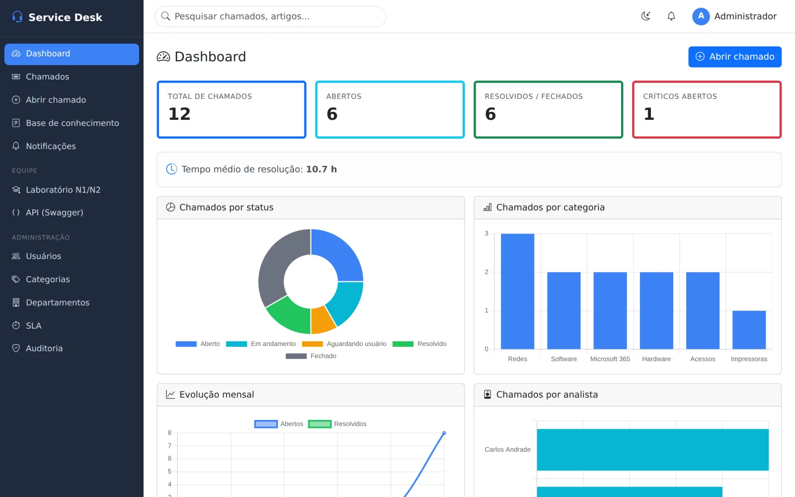
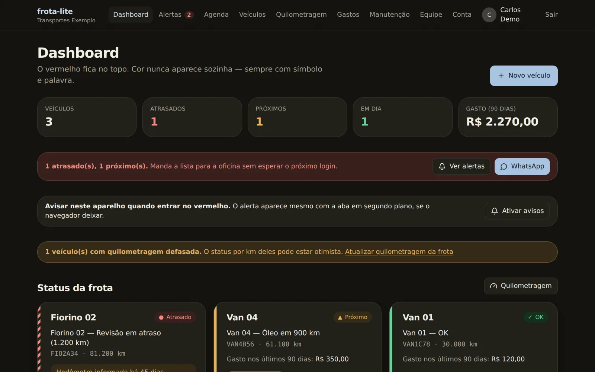
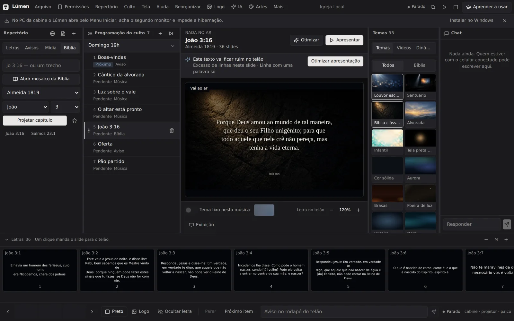
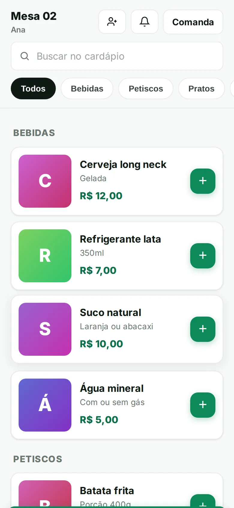
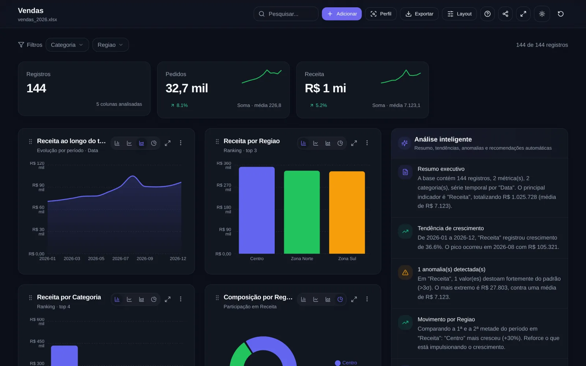
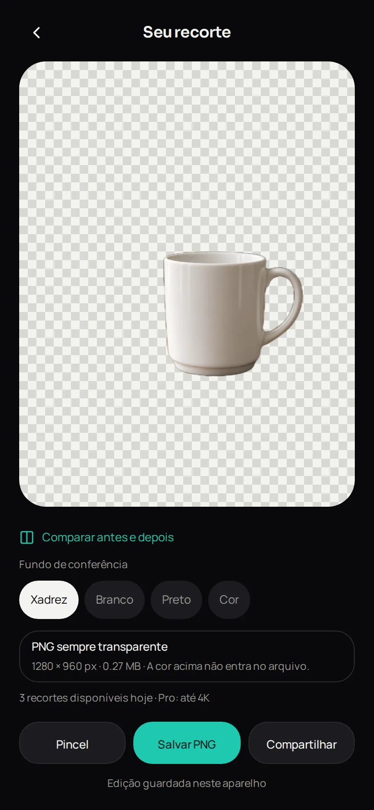
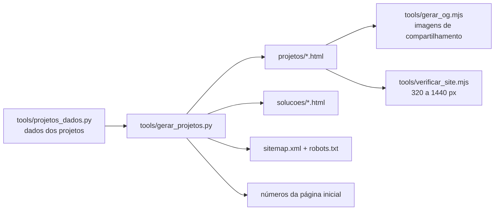

<div align="center">

# 🌐 Orleans — Projetos digitais

**Portfólio de sistemas SaaS, apps desktop e mobile e sites para operações pequenas, de oficinas a igrejas, com modo offline e privacidade no próprio aparelho.**

<br />

[](https://orleans-samai.github.io/)
[](index.html)
[](tools/gerar_projetos.py)
[](tools/verificar_site.mjs)
[](.github/workflows/verificar.yml)

**[🌐 Acessar o portfólio](https://orleans-samai.github.io/)**

[Sobre](#-sobre) •
[Projetos](#-projetos) •
[Telas](#-algumas-telas) •
[Como funciona](#-como-o-site-é-gerado) •
[Editar](#-como-editar) •
[Estrutura](#-estrutura-do-projeto)

</div>

---

## 📌 Sobre

Este repositório é o site pessoal hospedado no **GitHub Pages**. Ele apresenta os projetos em desenvolvimento, as soluções por segmento (igrejas, pequenos negócios e suporte de TI) e uma página para cada projeto, com status, progresso, telas e próximos passos.

O site é **HTML estático**, sem framework, com fonte Manrope hospedada localmente. As páginas de projeto são geradas por um script Python a partir de um único arquivo de dados, e uma verificação automática roda a cada push.

---

## 📂 Projetos

| Projeto | Segmento | O que é | Status |
|---|---|---|---|
| **EBike Suporte** | Bicicletarias | Pós-venda para lojas de bicicletas elétricas: ficha por bike, chamados e equipe com papéis | MVP |
| **Autoatendimento QR** | Restaurantes | Pedido por QR code, fila do garçom em tempo real e impressão na cozinha, na rede local | MVP |
| **Frota Lite** | Frotas | Manutenção preventiva para frotas pequenas, com a lista da oficina pronta | MVP |
| **Lúmen** | Igrejas | Projeção de culto para Windows: letra, Bíblia, avisos e mídia no telão, sem internet | Em teste |
| **Fundo Fora** | Vendedores | Remove o fundo da foto do produto no próprio celular e exporta PNG transparente | Em desenvolvimento |
| **Voice Finance** | Finanças pessoais | Registro de gastos por voz em português | Em desenvolvimento (em espera) |
| **Sistema de Chamados** | Suporte de TI | Service desk com SLA, base de conhecimento, auditoria e laboratório N1/N2 | MVP |
| **AI Orchestrator** | Desenvolvedores | CLI que coordena três agentes de IA (planejar, implementar, revisar) com aprovação humana | MVP |
| **Excel Dashboard** | Empresas | Transforma uma planilha Excel em painel com indicadores, gráficos e alertas | MVP |
| **Central da Festividade** | Igrejas | Programação, escalas, avisos, visitantes e intercessão da festividade num só lugar | Em teste |
| **SlideRevive Church AI** | Igrejas | Converte PDF ou PowerPoint da pregação em slides 16:9 para o telão | MVP |
| **NetDiag Pro** | Suporte de TI | Diagnóstico de rede que aponta a causa provável e gera relatório | MVP |
| **Backend Python Simulator** | Educação | Simulador de carreira backend com 433 desafios corrigidos executando o código | MVP |
| **AI Control Center** | Desenvolvedores | Painel das sessões do Claude Code e dos repositórios Git da máquina | Em desenvolvimento |

---

## 🖼 Algumas telas

<table>
<tr>
<td align="center"><br /><sub>Sistema de Chamados</sub></td>
<td align="center"><br /><sub>Frota Lite</sub></td>
<td align="center"><br /><sub>Lúmen</sub></td>
</tr>
<tr>
<td align="center"><br /><sub>Autoatendimento QR</sub></td>
<td align="center"><br /><sub>Excel Dashboard</sub></td>
<td align="center"><br /><sub>Fundo Fora</sub></td>
</tr>
</table>

---

## ⚙ Como o site é gerado



- **`gerar_projetos.py`** (só biblioteca padrão do Python 3) gera as 14 páginas de projeto, as 3 páginas por segmento, o `sitemap.xml`, o `robots.txt` e os números da página inicial.
- **`gerar_og.mjs`** cria as imagens `og/*.jpg` (1200×630) que aparecem ao compartilhar o link.
- **`verificar_site.mjs`** abre todas as páginas em 320, 390, 768, 1280 e 1440 px e confere erros, rolagem horizontal, links internos e imagens de compartilhamento.
- A GitHub Action **Verificar site** confirma que as páginas geradas estão atualizadas e roda a verificação a cada push.

> 🚧 Não edite `projetos/*.html` à mão: a próxima execução do gerador sobrescreve. Os números exibidos são só os conferidos no repositório de cada projeto, sem depoimentos ou métricas inventadas.

---

## 📝 Como editar

| Quero mudar... | Onde |
|---|---|
| Texto, status, percentual ou próxima tarefa de um projeto | `tools/projetos_dados.py` e depois rodar o gerador |
| Layout de todas as páginas de projeto | Função `page()` em `tools/gerar_projetos.py` ou `projetos/projeto.css` |
| WhatsApp, e-mail, agenda e contador de visitas (GoatCounter, sem cookies) | Objeto `SITE` no topo de `assets/site.js` |
| Página inicial | `index.html` |

```bash
python3 tools/gerar_projetos.py                 # regera todas as páginas
python3 tools/gerar_projetos.py frota-lite      # regera só uma

npm install --no-save playwright && npx playwright install chromium
node tools/gerar_og.mjs                         # imagens de compartilhamento
node tools/verificar_site.mjs                   # verificação responsiva
```

Para ver localmente, sirva a pasta com qualquer servidor estático, por exemplo `npx serve .`.

---

## 📁 Estrutura do projeto

```
orleans-samai.github.io/
├── index.html                # Página inicial
├── projetos/                 # 14 páginas de projeto (geradas) + projeto.css
├── solucoes/                 # Igrejas, pequenos negócios e suporte de TI (geradas)
├── assets/site.js            # Contatos e contador de visitas
├── img/                      # Foto e telas dos projetos
├── og/                       # Imagens de compartilhamento
├── fonts/                    # Manrope (licença OFL)
├── tools/                    # Gerador, dados, OG e verificação
└── .github/workflows/        # Verificação automática
```

---

## 👤 Autor

**Orleans Samai**

[](https://github.com/orleans-samai)

<div align="center">

<sub>Feito com 💙 por Orleans Samai</sub>

</div>
